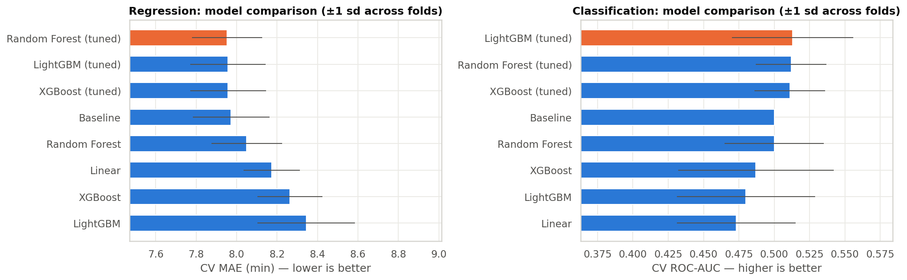
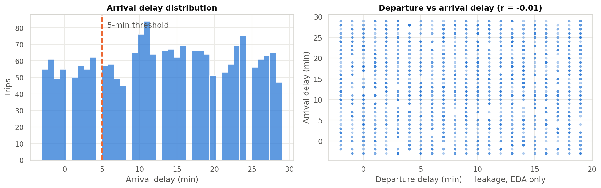
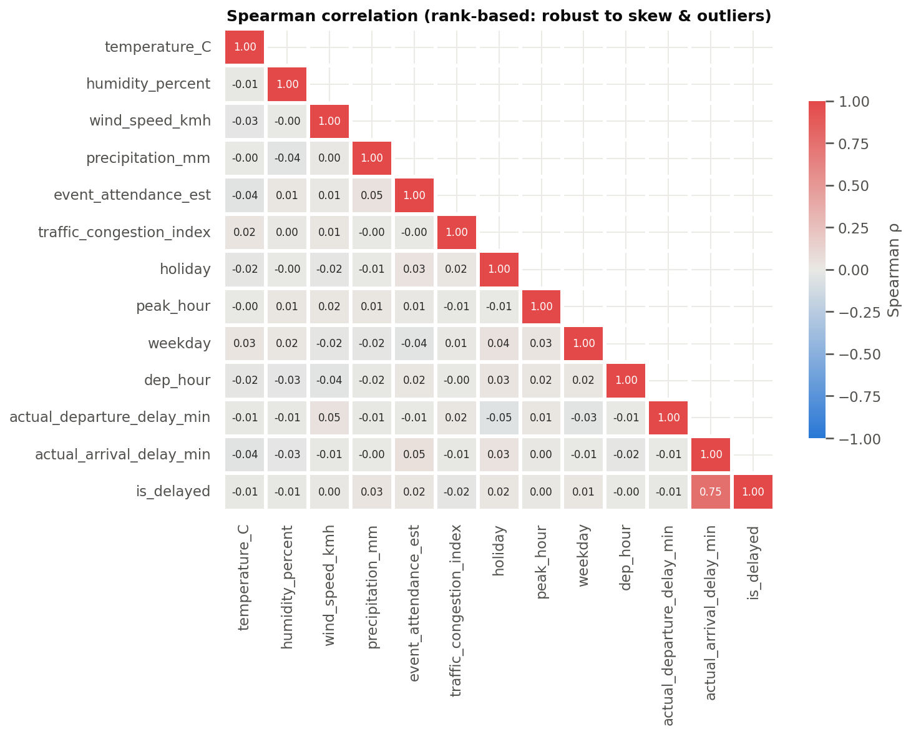
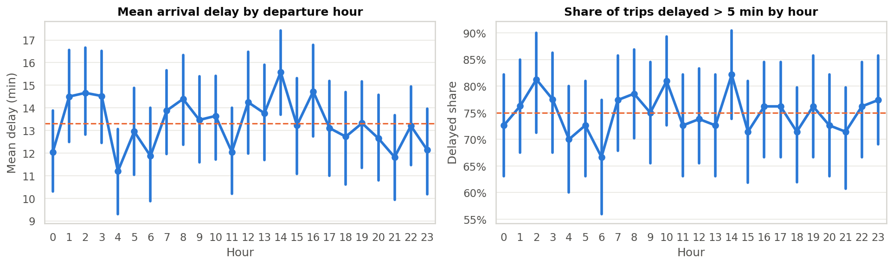
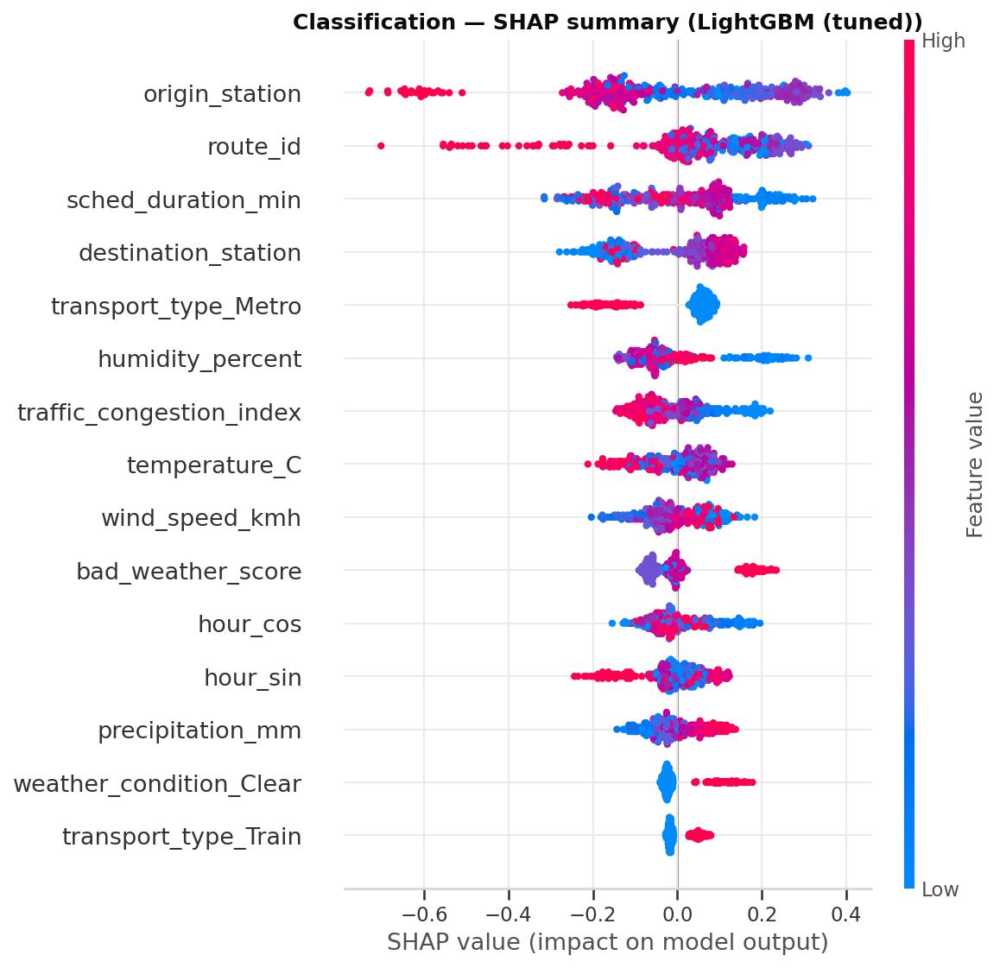

# 🚌 Transit Delay Prediction

**Can we predict whether a bus, tram or train will be late, using only information available *before* it departs?**

This is an end-to-end ML project covering problem framing, leakage-safe cleaning, EDA, feature engineering, time-aware validation, tuned gradient boosting, SHAP explainability and a Streamlit app. Its main result is an honest one: rigorous validation showed that the dataset contains **no learnable signal**, and the project shows how to prove that instead of reporting a misleadingly "good" model.

**[▶ Try the live app](https://transit-delay-prediction-app.streamlit.app)**



---

## 1. Problem

Unreliable service drives riders away faster than slow service does. A pre-departure delay forecast lets **dispatchers** add capacity before a delay builds up, lets **rider apps** warn "likely +8 min", and helps **planners** find fragile routes.

| Task | Target | Primary metric | Why |
|---|---|---|---|
| Regression | arrival delay (minutes) | **MAE** | Reported in minutes, so it's easy to explain, and robust to extreme delays |
| Classification | late by more than 5 min (yes/no) | **ROC-AUC** | Measures how well trips are ranked by risk, independent of any cut-off. Accuracy and F1 mislead when 75% of trips are late |

**Leakage rule:** only pre-departure information is allowed. `actual_departure_delay_min` and the provided `delayed` flag are recorded during or after the trip, so they are excluded, and an `assert` enforces this in code.

## 2. Data

[Public Transport Delays with Weather & Events](https://www.kaggle.com/datasets/khushikyad001/public-transport-delays-with-weather-and-events) (Kaggle): 2,000 trips across 4 modes, 20 routes and 50 stations, covering 1–21 January 2023. Each trip has its timetable, weather, event and congestion fields.

**Data-quality findings**
- pandas reads the literal `"None"` (meaning "no event") as missing by default. Reading it correctly avoids imputing values that were never missing.
- **A synthetic-data audit** found that the columns are generated independently:
  - departure delay vs arrival delay: r = −0.01
  - `season` doesn't match the month
  - "Clear" weather days record precipitation
  - every feature correlates with every other at |ρ| ≤ 0.05

## 3. Approach

```
raw CSV ─► cleaning & audit ─► EDA ─► Pipeline[ add_features ─► ColumnTransformer ─► model ]
                                                    │                 │
                                     time / weather / event   impute + scale + one-hot
                                     flags (src/features.py)  + TargetEncoder (routes, stations)
```

- **Time-aware validation:** the last 20% of the timeline is held out as the test set and touched once. Model selection uses 5-fold `TimeSeriesSplit` cross-validation on the earlier 80%, so the model always trains on the past and is validated on the future.
- **No preprocessing leakage:** imputation, scaling and target encoding are fitted inside the pipeline, on training folds only.
- **Models:** mean predictor / class prior → Ridge / logistic regression → Random Forest, XGBoost, LightGBM, each tuned with **Optuna** (30 TPE trials per model and task).
- **Threshold tuning:** the classification threshold is chosen for best F1 on out-of-fold training predictions, not on the test set.
- **Signal check:** a permutation test (30 shuffles) compares the model against copies trained on shuffled targets.
- **Explainability:** built-in importance, SHAP, and permutation importance on the test period.

## 4. Results

**Regression: arrival delay in minutes** (best by CV first; full table in `reports/results_regression.md`)

| Model | CV MAE | Test MAE | Test R² |
|---|---:|---:|---:|
| Random Forest (tuned) | **7.953** ± 0.17 | 8.170 | −0.009 |
| LightGBM (tuned) | 7.957 ± 0.19 | 8.161 | −0.010 |
| XGBoost (tuned) | 7.958 ± 0.19 | 8.169 | −0.007 |
| **Mean predictor (baseline)** | 7.973 ± 0.19 | **8.155** | −0.004 |
| LightGBM (default) | 8.344 ± 0.24 | 8.557 | −0.122 |

**Classification: late by more than 5 min** (full table in `reports/results_classification.md`)

| Model | CV ROC-AUC | Test ROC-AUC | Test PR-AUC | Test F1 |
|---|---:|---:|---:|---:|
| LightGBM (tuned) | **0.513** ± 0.04 | 0.459 | 0.755 | 0.867 |
| Random Forest (tuned) | 0.512 ± 0.03 | 0.475 | 0.767 | 0.868 |
| **Class prior (baseline)** | 0.500 | 0.500 | 0.768 | 0.868 |
| Logistic regression | 0.473 ± 0.04 | 0.478 | 0.764 | 0.868 |

**Permutation test:** p = 0.65 for regression and p = 0.26 for classification. Models trained on shuffled labels perform just as well.

### What this means
- **No model beats the baseline.** The tuned models gain 0.02 min in CV and *lose* on the test set. Tuning worked by regularizing the models until they predicted something close to the mean.
- **Untuned boosting overfits noise.** Default LightGBM is 4.7% *worse* than the mean predictor. Without a baseline you'd never notice that.
- **F1 = 0.87 looks great and means nothing.** 77% of test trips are late, so flagging every trip as late produces the same F1. That's why ROC-AUC is the primary metric.
- **SHAP ranks `origin_station` and `route_id` highest, yet shuffling any input changes test MAE by at most 0.03 min.** SHAP explains the model, not the world. High-cardinality features give a tree the most room to fit noise.

| | |
|---|---|
|  |  |
|  |  |

**Conclusion:** the delays in this dataset behave like random noise with respect to every available feature. The pipeline, validation design and leakage controls are what carry over to real data, and they're built so that a dataset with real signal can be swapped in without code changes.

## 5. Streamlit app

`app/app.py` takes a route, time, weather and event as input and returns the predicted delay, P(late by more than 5 min) and a verdict. It loads the same pipeline objects that were evaluated, so it applies exactly the same features and preprocessing as training. Input sliders are limited to the ranges seen in training.

**▶ Live demo: [transit-delay-prediction-app.streamlit.app](https://transit-delay-prediction-app.streamlit.app)**

## 6. How to run

```bash
git clone https://github.com/asilbek-maker/transit-delay-prediction.git
cd transit-delay-prediction
python -m venv .venv && source .venv/bin/activate   # Windows: .venv\Scripts\activate
pip install -r requirements.txt

# Notebook (or open it in Google Colab and Run all; it downloads the data itself)
jupyter notebook notebooks/transit_delay_prediction.ipynb

# App
streamlit run app/app.py
```

`requirements.txt` is pinned to the versions the models were trained with (Python 3.12), because pickled scikit-learn pipelines are version-sensitive. All randomness is seeded (`SEED = 42`).

```
├── app/app.py                  Streamlit app
├── data/raw, data/processed    (git-ignored: Kaggle licence)
├── models/                     trained pipelines + metadata.json
├── notebooks/                  end-to-end notebook (Phases 1–7)
├── reports/figures/            all charts used here
├── reports/results_*.md        full model comparison tables
├── src/features.py             shared feature engineering + preprocessing
└── requirements.txt
```

## 7. Future work
- **Real data:** GTFS-Realtime feeds (for example from a city's open-data portal) joined to historical weather and event calendars.
- **Delay propagation:** lag features such as the previous trip's delay on the same route, which is the strongest real-world predictor.
- **Geospatial event proximity:** distance from route to venue and minutes until the event ends.
- **Probabilistic forecasts:** quantile regression ("90% chance you arrive within 12 min") instead of a single point estimate.
- **Monitoring:** data-drift checks and scheduled retraining once the model is live.

## Limitations
The data is synthetic and covers only three weeks, so seasonality can't be learned and no finding transfers to a real transit network.
